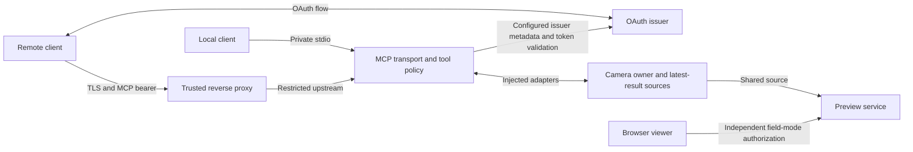

# MCP ADR — Threat model and access policy

**Status** Accepted.

## Context and trust boundaries

The current MCP spike exchanges synthetic responses over client-launched
stdio. The existing camera API has its own FastAPI lifespan and HTTP field-mode
policy. The boundaries below show the selected local stdio profile and the
planned remote profile. The camera owner keeps one capture pipeline and owns
the optional JPEG and inference sources.
[Camera ownership and host lifecycle](ADR-mcp-camera-ownership.md) ·
[SDK spike](../../examples/mcp_runtime_spike/server.py) ·
[FastAPI app and lifespan](../../imx_camera_toolkit/_internal/api/api.py#L370-L442) ·
[Runtime ADR](ADR-mcp-python-sdk-runtime.md) ·
[Local SDK and transport ADR](ADR-mcp-local-sdk-and-transport.md)

The local operator controls the executable, launch environment, configuration
and grants. With stdio, possession of the private pipes carries the configured
authority for that invocation. Other users and processes must be unable to
attach to those pipes. The local profile assumes a trusted OS account. A process
with the same OS privileges as the launcher can already access its authority.
An authenticated client, including an agent manipulated by its inputs, can still
request any operation within its own grants. Treat every request and every
image or model payload as untrusted input. The remote profile also assumes
requests from unauthenticated clients and authenticated callers with narrow grants.

| Protected data or operation | Required boundary |
| --- | --- |
| Capture state, FPS, counters, sensor metadata, public aliases and observation timestamps | Observer grant. Project the approved response fields and omit serial numbers, private subscription names, process diagnostics and filesystem paths. |
| JPEG bytes and associated acquisition age, sequence and timestamps | Explicit snapshot grant. Return an in-memory bounded JPEG with no EXIF and timing correlated to that image. |
| Inference worker state, model and source IDs, publication timing and application-mapped results | Explicit inference grant. Publish allowlisted identifiers and bounded schema-validated output. Raw tensors, private model paths and free-form exception text stay inside the application. |
| Current settings, control changes, controller revision and capture availability | Explicit control grant and an enabled tool. Apply only operator-configured fields through the camera controller. Capabilities expose supported bounds to observers. |
| Bearer credentials, browser sessions, IPC peer identity, and audit records | Confine credentials to their transport or service. Restrict diagnostic access and record only approved audit fields. |
| Preview location, media and signaling | Separate MCP preview discovery grant if the feature ships. The preview service authorizes the viewer independently. |

## Scope and tool policy

Use MCP-specific scopes for both local launch grants and remote tokens. A grant
is additive and applies only to its named operation. The profile names below
are examples of grant sets. The API accepts explicit scopes, and the caller
cannot select a grant set in request arguments or protocol metadata.

| Enabled tool | Required scope | Observer | Vision | Inference reader | Operator | HTTP admin or `admin` alone | Target release |
| --- | --- | --- | --- | --- | --- | --- | --- |
| `camera_status` | `mcp:camera:status` | Allow | Allow | Allow | Allow | Deny | v0.9.0 |
| `camera_capabilities` | `mcp:camera:status` | Allow | Allow | Allow | Allow | Deny | v0.9.0 |
| `camera_snapshot` | `mcp:snapshot:read` | Deny | Allow | Deny | Deny | Deny | v0.9.0 |
| `inference_status` | `mcp:inference:read` | Deny | Deny | Allow | Deny | Deny | v0.9.1 |
| `inference_latest` | `mcp:inference:read` | Deny | Deny | Allow | Deny | Deny | v0.9.1 |
| `camera_set_controls` | `mcp:camera:control` | Deny | Deny | Deny | Allow | Deny | v0.9.2 |
| `preview_get_url` | `mcp:preview:read` | Deny | Deny | Deny | Deny | Deny | Conditional |

Each named profile above has `mcp:camera:status`. Vision adds
`mcp:snapshot:read`, the inference reader adds `mcp:inference:read`, and the
operator adds `mcp:camera:control`. A principal may receive any combination
of explicit grants. In particular, a preview-only grant permits only the
enabled `preview_get_url` operation. An empty scope set exposes no tools.
There is no MCP admin scope, wildcard, role inheritance or translation from
legacy scopes. HTTP field mode continues to use `stream:read` for media and
signaling, `camera:read` for read routes, `camera:control` for updates,
`profiles:write` for profile mutation and `admin` for full HTTP access.
A valid HTTP field-mode credential remains scoped to that service.
[HTTP scope definitions](../../imx_camera_toolkit/_internal/api/security.py#L26-L35) ·
[HTTP credential enforcement](../../imx_camera_toolkit/_internal/api/security.py#L602-L641) ·
[HTTP route declarations](../../imx_camera_toolkit/_internal/api/api.py#L450-L760)

| Operation | Rule |
| --- | --- |
| Transport discovery or initialization | Expose only protocol metadata. Apply the profile's request authentication rules. Future public OAuth resource metadata contains discovery information only. |
| `tools/list` | Return the intersection of enabled and granted tools in deterministic order. Scope any discovery cache and pagination cursor to the authorized view, and recheck the current request's grants. |
| `tools/call` by name | Authenticate as required by the profile. Resolve the enabled tool and independently check its scope before validating domain arguments or accessing the camera, sources, controller or expensive work slots. Only authorized calls proceed to validation and admission. |
| Disabled or unknown tool | Omit from discovery, and give both names the same revision-appropriate protocol lookup error for an admitted caller. A tool absent from the release is disabled. |
| Enabled tool, missing scope | Omit from discovery. Reject local direct calls reaching tool policy with the domain error `permission_denied`. Remote scope checks at HTTP ingress return `403` with the applicable OAuth challenge. Retain the same scope check at dispatch. |
| Other features and state | Expose camera data only through the listed tools. Resource reads or subscriptions, prompts, model loading, camera selection beyond the registered source, profile writes and capture lifecycle commands have no MCP entry point in this design. |

Resolve remote identity on every protected request. A connection, session ID,
request ID, cached list or tool annotation conveys no authority. Use the same
allowlist and scope table for discovery and dispatch. Keep results and
principal-specific discovery out of shared caches. Verify tool policy on
both local and remote transports before releasing them.
[MCP tools and authorized discovery](https://modelcontextprotocol.io/specification/2026-07-28/server/tools) ·
[Tool result and error contracts](../mcp/README.md#errors-and-mcp-representation)

## Local profile

Start with the observer scope and the two status/capabilities tools. For the
local demo, the application operator configures the existing bounded JPEG
source, enables `camera_snapshot`, and explicitly adds `mcp:snapshot:read` to
the demo client's grants. Inference and write tools are unavailable in v0.9.0.
The v0.9.1 inference example enables its source and adds `mcp:inference:read`
explicitly.

Launch the intended executable with fixed arguments and a minimal environment,
use private pipes, and reserve stdout for protocol messages. The local MCP
profile has no network listener. If a future runtime decision requires a
sidecar, use OS-restricted IPC with verified peer identity and a fixed camera
operation allowlist. Require bounded messages and deadlines, and keep caller
credentials out of IPC. The broker authorizes each call before forwarding it,
while the camera owner authorizes the sidecar peer and permitted operations.
[Local observer guide](../MCP_GUIDE.md) ·
[Local launch and lifecycle](ADR-mcp-local-sdk-and-transport.md#hosting-and-lifecycle)

## Remote profile

Remote access is disabled by default. Remote deployment must define issuer
selection, client registration and compatibility, token format, key rotation,
the canonical HTTPS resource URI, Protected Resource Metadata and challenge
behavior. The issuer authenticates and issues audience-bound access tokens.
The MCP resource server
validates each presented bearer credential for authenticity, issuer, intended
resource, validity window and granted scopes before protected processing. Use
the validated issuer and subject or approved service identity for principal
accounting. Reject invalid or missing credentials with `401` and valid
credentials lacking required scopes with the applicable `403` challenge.
Check the chosen revision for malformed authorization requests. Fail closed on
invalid startup configuration or unverifiable credentials.

Enforce TLS and trusted proxy boundaries. Restrict upstream connections
to the configured proxy, strip untrusted forwarding and identity headers,
and enforce exact `Host` and `Origin` policy. Use HTTPS and configured targets
for metadata and key or introspection access, with bounded, allowlisted egress.
Accept MCP bearers only in the authorization header and only for the MCP
resource. The proxy and MCP service keep secrets out of logs and caches.
Browser cookies, HTTP field-mode tokens and MCP bearers are service-specific.
Calls never forward user tokens to the camera or preview services.
[MCP authorization requirements](https://modelcontextprotocol.io/specification/2026-07-28/basic/authorization)

Apply the audit policy across the service and proxy. Retain server time,
correlation ID, operation, a pseudonymous validated principal identifier,
outcome and latency. Record denial and limit events. For controls record the
allowed field names and committed revision. Exclude raw arguments and settings
values, media, model payloads, prompts, credentials, private paths, and raw
exceptions from logs, traces and metrics. Keep responses out of diagnostic
storage. Require an operator-configured short, finite retention period and
deletion for audit records, with restricted read access and automatic expiry.
Keep telemetry local by default. The integrator controls any retention or
onward disclosure after authorized data reaches the client.

## Threats and acceptance evidence

The scenarios below are design risks. Implementation owners record test
evidence and the release maintainer checks it against the release gate.

| Threat | Required safeguard | Planned verification |
| --- | --- | --- |
| Observer, unprivileged process or client with stale discovery invokes a sensitive tool | Default deny on both list and direct call. Apply the same rules for role combinations and feature flags. Authenticate peers at the local transport or IPC boundary. | Exercise every matrix cell in list and direct calls, including empty grants, each scope in isolation, combinations, preview-only, unrelated scopes and `admin`. Repeat with enabled/disabled tools and different credentials on the same HTTP connection. Assert denied calls make zero camera reads, worker reservations or controller calls. |
| Another process inherits the local channel, or a client bypasses the remote proxy | Private stdio, minimal child environment, strict remote Host/Origin checks and restricted upstream access. | Verify the local subprocess opens no MCP listener and keeps protocol output on stdout. Test remote missing credentials, cross-origin and disallowed Host rejection, restrictions on upstream access and spoofed forwarding headers. Verify local IPC rejects an unauthorized peer if used. |
| Remote token replay across services or invalid credential use | Resource-specific validation, separate preview auth and per-request grants. | Verify the metadata/challenge flow with a real client. Test missing, malformed, expired, wrong-issuer, wrong-audience and insufficient-scope credentials and key rotation. Confirm HTTP field-mode grants and admin still behave as before. |
| Caller or proxy exhausts memory, CPU or worker capacity | Bound ingress before decoding, then enforce rate/burst, per-tool and global concurrency, deadlines and response size. Release work slots when work actually completes. | Test oversize, burst, disconnect, slow requests and recovery with two principals. Use the documented snapshot ceilings and measure capture/inference under matched load before release. |
| Request attempts to redirect network or filesystem access | No tool accepts a fetch URL, callback, filesystem path or model path. Preview discovery may return only a configured allowlisted HTTPS URL without embedded credentials. The MCP service never fetches that preview URL. | Reject unexpected arguments and invalid configured URL origins or schemes. Verify a returned preview URL alone grants no media or signaling access. Check issuer egress against configured trust. |
| Misleading image, inference text or stale data influences an agent | Treat payloads as data and preserve independent authorization for every operation. Use correlated snapshot timing and explicit inference freshness. Poll an existing worker and use an application-mapped schema. | Use synthetic data containing instruction-like content and assert it cannot change grants or trigger server-side dispatch. Check stale, missing and mismatched provenance cases. |
| Payloads or credentials leak through responses, logging or caches | Allowlist response and audit fields, sanitize errors, and apply retention and cache policy. | Inspect application and proxy output with synthetic sensitive values including headers, JPEG, model fields, control values and exceptions. Verify cross-principal cache isolation and log expiry. |
| Authorized control abuse disrupts other consumers | Explicitly enable writes, then require the control grant, allowlisted fields, validated ranges, bounded update rate and audit. Check restart requirements inside the controller transition. Initial policy rejects restart-requiring changes. | Cover disabled tool, missing scope, invalid values, cooldown, concurrent updates and apply failure. Confirm the prior settings and revision survive failed writes and permitted changes preserve other consumers on Jetson. |

Complete the security review before any remote release. Record
the actual issuer, proxy, accepted client revisions and operator retention
setting in the remote deployment work.
[Release checklist](../RELEASE_CHECKLIST.md#mcp-release-gates)
